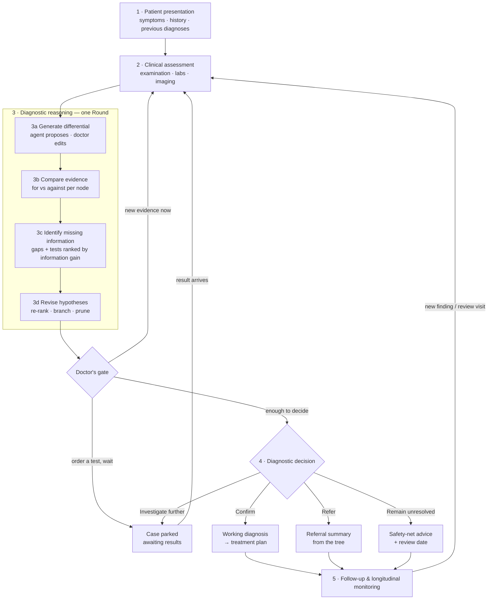

# User flow — GP & pediatrician working a case on the reasoning tree

- **Status:** draft for review · 2026-10-17
- **Users:** general practitioners (GPs) and pediatricians in primary / outpatient care
- **Builds on:** `CONTEXT.md`, `docs/recipes/`, ADR 0002 (the Next-action rail)

## 1. Who we design for

| | GP | Pediatrician |
|---|---|---|
| Consult length | ~10–15 min, often back-to-back | ~15–20 min |
| Who gives the history | The patient | Often a parent or guardian, sometimes the child |
| Typical case | Undifferentiated symptoms, many self-limiting, a few serious ones | Fever, rash, cough, abdominal pain, growth and development worries |
| Test results arrive | Hours to days later, not during the consult | Same |
| Common legitimate outcomes | Watchful waiting, safety-netting, referral | Same, with lower thresholds in infants |
| What changes the base rates | Age, sex, comorbidities, local epidemiology | Age **in months**, weight, vaccination status, birth history, development, nursery/school outbreaks |

Three consequences shape the whole flow:

1. **The case must be parkable.** A GP rarely reaches a diagnosis in one sitting.
   Arbor must let the doctor stop mid-loop, wait for results, and resume.
2. **"No diagnosis yet" is a valid outcome.** Refer, investigate further, and
   remain unresolved (with safety-netting) are first-class decisions, not
   failures.
3. **The doctor overrides the agent at every step.** The doctor's clinical
   judgment wins. Each override is recorded on the reasoning trail with "by
   clinician", so the reasoning stays auditable.

## 2. What the tree does

The reasoning tree is the **map of the case**. It is always on screen and is
the place where the doctor acts.

- **Shows:** the live differential (ranked by probability mass), why each node
  exists (`branchedBecause`), horses vs 🦓 zebras, must-not-miss flags, and
  ruled-out branches (dimmed, never deleted).
- **Navigates:** selecting a node opens its evidence for and against, its base
  rate, its codes and its discriminating tests. The time-travel scrubber
  (`Timeline.tsx`) replays how the tree looked at each round and at each visit.
- **Takes decisions:** the doctor acts *on the node* (add, pin, rule out, choose
  a test, confirm). The agent's proposals show as suggestions on the tree until
  the doctor accepts them.

Every tree change carries an author: 🤖 agent-proposed · 🩺 clinician-decided.

### Node actions (the doctor's toolkit on the tree)

| Action | Meaning | Recorded on trail as |
|---|---|---|
| **Open** | Show the evidence panel for this hypothesis | — |
| **Pin as must-not-miss** | Keep it on the tree regardless of probability (e.g. meningitis in a febrile infant) | "Pinned by clinician: <reason>" |
| **Rule out** | Prune with a required one-line reason; the node stays, dimmed | "Ruled out by clinician: <reason>" |
| **Restore** | Bring a ruled-out node back to live | "Restored by clinician" |
| **Add hypothesis** | Add the doctor's own candidate (top-level or as a child) | "Added by clinician" |
| **Disagree with weight** | Mark the agent's ranking as too high or too low; the next round must take it into account | "Clinician: likely higher/lower because …" |
| **Choose test** | Pick one of the proposed discriminating tests, or enter a different one | "Ordered by clinician" |
| **Confirm** | Set this node as the working diagnosis | "Confirmed by clinician" |

## 3. The flow

Each step below lists: **what the doctor sees**, **what the agent does**,
**what the doctor decides**, and **what the tree shows**.

---

### Step 1 · Patient presentation

*Symptoms · history · previous diagnoses*

**Doctor sees** a structured intake form, pre-filled from a free-text note or a
dictated summary (the `intake` agent / `interviewing-expert`).

- Chief complaint, in the patient's or parent's words
- History of presenting complaint (onset, course, severity)
- **Previous diagnoses and comorbidities** as a list, each tagged *active /
  resolved*
- Medications and allergies
- Demographics → base-rate context: age (**months under 2 years**, with
  weeks for neonates), sex, location, ethnicity where relevant
- **Pediatric block** (shown when age < 18): historian (parent / guardian /
  child), weight, vaccination status, birth history, developmental concerns,
  sick contacts at nursery or school

**Agent does:** structures the free text, highlights red flags in the history
(e.g. non-blanching rash, fever under 3 months), and shows which demographic
stratum it will use for priors.

**Doctor decides:**
- Accept or correct each extracted field (nothing is used until the doctor
  accepts it)
- Confirm the base-rate context ("Use priors for: 14-month-old, Berlin")
- **Start reasoning** — or add more history first

**Tree shows:** one root — the presentation — with a "priors" badge. No
hypotheses yet.

---

### Step 2 · Clinical assessment

*Examination · laboratory results · imaging*

**Doctor sees** three entry lanes, each producing **Findings**:

| Lane | Typical entries | Finding `source` |
|---|---|---|
| Examination | Vitals (age-adjusted ranges for children), focused exam | `exam` |
| Laboratory | Point-of-care (CRP, urine dip, rapid strep) and sent-off labs | `lab` |
| Imaging | X-ray, ultrasound reports | `imaging` *(new)* |

Each finding can be marked **pending** (ordered, result not back), **normal**,
or **abnormal**. Vitals outside the age-adjusted range are flagged
automatically; the doctor can dismiss the flag.

**Agent does:** proposes how each finding bears on the current hypotheses
(supports / against / neutral).

**Doctor decides:** accept or change the direction of each finding; nothing
counts as evidence until the doctor accepts it.

**Tree shows:** new findings as small chips that fly to the nodes they affect
(micro-animation), before the round recomputes.

---

### Step 3 · Diagnostic reasoning (the loop)

One pass through 3a → 3d is one **Round** (`server/domain/engine.ts`). The
doctor can stop the loop at any gate.

#### 3a · Generate differential diagnoses

**Agent does:** proposes the differential with probability mass, horses first,
zebras flagged 🦓, base-rate notes per node.

**Doctor decides:** on the tree — add their own hypothesis, pin
must-not-miss, rule out with a reason, or **accept the differential**.

**Tree shows:** first-level branches grow from the root. Agent proposals that
are not yet accepted appear outlined (ghost style); they fill in when accepted.

#### 3b · Compare supporting and conflicting evidence

**Doctor sees** (node selected): two columns, **For** and **Against**, each
finding with its weight phrase and citations (`DetailPanel.tsx`,
`FindingsView.tsx`). Findings with *no* bearing on the leading hypotheses are
grouped as "unexplained", which is a cue for a missed diagnosis.

**Doctor decides:** "disagree with weight" on any finding, or on the node's
rank.

**Tree shows:** for/against counts on each node; conflicting evidence is marked
on the node edge.

#### 3c · Identify missing information

**Agent does:** lists the **gaps**: questions not yet asked, exam signs not
yet checked, and tests, each ranked by how well it **splits** the current
differential (information gain). Each gap says which nodes it separates.

**Doctor decides**, for each gap:
- **Ask / examine now** → goes back to Step 1/2 within the same consult
- **Order test** → test status `ordered`; the case can be parked
- **Choose a different test** (free text)
- **Not available / not appropriate** (e.g. no ultrasound in the practice, or
  invasive in a child), with a reason; the agent must then propose an
  alternative

**Tree shows:** each proposed test as a small diamond between the nodes it
discriminates. Hovering it highlights those nodes.

#### 3d · Revise diagnostic hypotheses

**Agent does:** re-ranks, branches a hypothesis when a finding splits it,
proposes rule-outs.

**Doctor sees** a **round diff**: "↑ Viral URTI 45→62% · ↓ Strep 30→12% ·
branched Otitis media → AOM / OME · ruled out: Pneumonia (normal chest exam)"
(`timeTravel.ts › describeDiff`).

**Doctor decides:** accept the revision, or reject a specific change (for
example, refuse a proposed rule-out of a must-not-miss node).

**Tree shows:** animated re-rank: branches grow, and pruned nodes dim in place
and are not removed.

#### The gate after each round

The Next-action rail (`NextAction.tsx`) offers exactly one primary action and
the alternatives:

| Option | When |
|---|---|
| **Add finding & run next round** | New evidence available now |
| **Order test & park case** | Waiting for results; case shows as *Awaiting results* on the case list |
| **Go to decision** | The doctor judges there is enough to decide (available at any time, not only when the agent says "converged") |

---

### Step 4 · Diagnostic decision

*Confirm · Refer · Investigate further · Remain unresolved*

The decision panel opens with the leading hypothesis preselected, but **the
doctor may pick any live node**. The agent offers a recommendation and its
confidence; the doctor's choice is final.

| Decision | Doctor provides | Arbor produces | Case status |
|---|---|---|---|
| **Confirm** | Choose the node, confidence, short note | Working diagnosis + reasoning trail → treatment plan (`treatment.ts`) | `converged` → `treatment` |
| **Refer** | Specialty, urgency (routine / urgent / emergency), question for the specialist | Referral summary generated from the tree: presentation, findings, differential, what was ruled out and why, open questions | `referred` *(new)* |
| **Investigate further** | Which tests are ordered | Order list; case is parked | `awaiting_results` *(new)* |
| **Remain unresolved** | Review interval, safety-netting points | Safety-net advice (what to watch for, when to return) — plain language for the patient or parent | `monitoring` *(new)* |

Guards:
- Confirming while a pinned **must-not-miss** node is still live asks the doctor
  to state why it is acceptable (one line, saved on the trail).
- "Remain unresolved" requires a review date.

**Tree shows:** the confirmed node in the confirmed colour, with the path from
the root highlighted (the reasoning trail). For refer and unresolved, the tree
stays open with a status banner.

---

### Step 5 · Follow-up and longitudinal monitoring

*New findings can restart the reasoning loop*

**Doctor sees** the case on a list grouped by status: *Awaiting results ·
Monitoring · Referred · Treated*, with due review dates.

Re-opening a case starts a new **encounter** (a visit):
- The tree from the last visit is restored as it was; the scrubber gains an
  encounter marker ("Visit 2 · 3 days later").
- New results, new symptoms, specialist feedback or response to treatment are
  entered as findings → back to **Step 2**.
- If a confirmed diagnosis is contradicted, the doctor can **re-open the
  differential**: the working diagnosis returns to live, and the trail records
  why.

**Tree shows:** the same tree, continued. Earlier rounds stay reachable on the
scrubber, so the full longitudinal story can be replayed.

---

## 4. Worked example — pediatric fever

14-month-old, fever 39.4 °C for 2 days, irritable, reduced feeding. Mother is
the historian.

1. **Presentation:** the doctor dictates; Arbor extracts the fields and the
   pediatric block (vaccinations up to date, nursery). It sets priors for a
   12–24-month-old.
2. **Assessment:** HR 160, cap refill < 2 s, red bulging right TM, no rash,
   no neck stiffness.
3. **Round 1:** the agent proposes Acute otitis media 55% · Viral URTI 25% ·
   UTI 12% · 🦓 Bacterial meningitis 3%. The doctor **pins meningitis as
   must-not-miss** and accepts.
   Missing info: urine dip (splits UTI vs AOM-only). The doctor orders it as a
   point-of-care test now.
4. **Round 2:** urine dip negative → UTI drops and is ruled out (agent-proposed,
   doctor-accepted). AOM rises to 78%.
5. **Decision:** **Confirm** AOM. The guard asks about pinned meningitis; the
   doctor notes "well-appearing, no meningism, normal cap refill" → treatment
   plan with safety-netting for the parent.
6. **Follow-up:** 3 days later still febrile → **re-open**, Visit 2, new
   findings, the loop restarts on the same tree.

## 5. Mapping to the current prototype

| Flow step | Exists today | Gap to build |
|---|---|---|
| 1 Presentation | `Presentation` in `server/domain/types.ts`; scenarios in `web/src/scenarios.ts`; blank case in `App.tsx` | No structured **previous diagnoses** (only `comorbidities: string[]`); age in **years only**; no pediatric block; the intake agent is not surfaced in the UI (see `docs/HANDOFF.md`) |
| 2 Assessment | `Finding` with `source: exam \| lab \| …`; inline finding form in `NextAction.tsx` | No `imaging` source; `observations` is a flat list; no pending/normal/abnormal state; no age-adjusted vitals |
| 3a Generate | Engine round, zebra flag, base-rate notes, `DecisionTree.tsx` | Doctor cannot **add**, **pin**, or **rule out** a hypothesis — needs new endpoints and node actions |
| 3b Compare | `evidenceFor/Against`, `DetailPanel.tsx`, `FindingsView.tsx`, citations | No "disagree with weight"; no "unexplained findings" group |
| 3c Missing info | `decision.kind: "gather"` (single reason); `discriminatingTests` per node | No structured **gap list**; no "not available" path; tests not drawn on the tree |
| 3d Revise | Merge + `normalizeTree`; `history` frames; `timeTravel.ts › describeDiff` | Diff not shown as an accept/reject step |
| Gate | `NextAction.tsx`, `awaitingHitl` | No **park case**; "set working dx" exists but no general "go to decision" |
| 4 Decision | `POST /diagnose`, `POST /treat`, `WorkingDiagnosis`, `TreatmentPlan` | Only **Confirm** exists. Needs Refer / Investigate / Unresolved, new `CaseStatus` values, referral summary, safety-net output |
| 5 Follow-up | `history` tape + `Timeline.tsx` scrubber | No **encounters**, no reopen after `converged`/`closed`, no case list by status, no review dates |
| Attribution | `CaseEvent`, `FindingSource: clinician` | Tree changes have no agent/clinician author field |

### Proposed domain additions (server first, then mirror in `web/src/types.ts`)

- `Presentation.pastDiagnoses?: { name; status: "active" | "resolved"; code? }[]`
- `Presentation.medications?`, `allergies?`
- `Demographics.ageMonths?` and `Demographics.pediatric?: { historian; weightKg; vaccination; birthHistory; development; sickContacts }`
- `FindingSource` += `"imaging"`; `Finding.state?: "pending" | "normal" | "abnormal"`
- `Hypothesis.pinned?: { reason }`, `Hypothesis.author: "agent" | "clinician"`, `Hypothesis.ruledOutReason?`
- `CaseStatus` += `"awaiting_results" | "referred" | "monitoring"`
- `Case.decision?: { kind: "confirm" | "refer" | "investigate" | "unresolved"; … }`
- `Case.encounters: { id; at; label }[]`; `HistoryEntry.encounterId`
- `Case.gaps?: { kind: "question" | "exam" | "test"; text; splits: hypothesisId[] }[]` (engine JSON contract gains `missing`)

New endpoints (sketch): `POST /cases/:id/hypotheses` (add),
`PATCH /cases/:id/hypotheses/:hid` (pin / rule out / restore / weight note),
`POST /cases/:id/decision`, `POST /cases/:id/encounters` (reopen).

## 6. Suggested build order

1. **Doctor actions on the tree** (add, pin, rule out, restore) + author field.
   Highest value: it makes the doctor's discretion visible on the tree.
2. **Four-way decision panel** + new statuses + safety-net and referral output.
3. **Missing-information list** (engine contract + UI) and tests drawn on the tree.
4. **Structured presentation** (previous diagnoses, pediatric block, age in months).
5. **Assessment lanes** (exam / lab / imaging, pending state).
6. **Park, case list, encounters, reopen** — longitudinal follow-up.

Each item needs a screen/component spec in `../screens/` or `../components/`
before it is built, and a Guided-tour update in `web/src/tutorialCase.ts` so
the feature can be shown without the API.

## 7. Open questions for the team

- Should the doctor be able to edit probabilities directly, or only nudge them
  ("likely higher/lower")? Direct edits conflict with server normalization.
  This draft proposes nudges only.
- What red-flag / traffic-light framework should the pediatric block follow
  (e.g. NICE NG143 for fever in under-5s)? It needs clinical sign-off.
- Is the referral summary a PDF, a copy-paste text, or an export to the
  practice system?
- Where do cases persist between visits? The case store is in-memory today
  (`server/domain/case-store.ts`).
